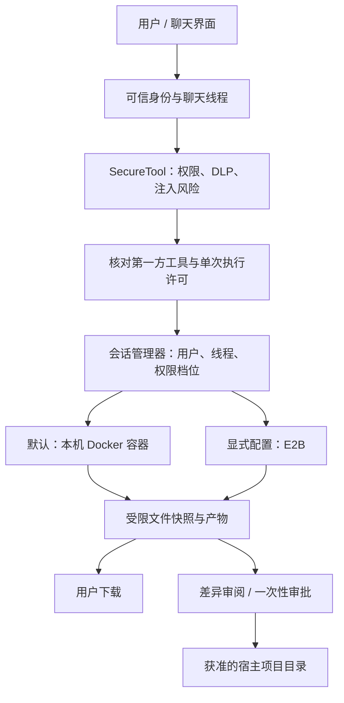

# Weaver：Docker 优先的自托管执行沙箱

本文描述 v0.7.0 中统一的托管沙箱实现。默认 `SANDBOX_MODE=docker`，Python、Shell 和工作文件都在本机 Docker 任务容器中处理；E2B 仅在管理员显式设置 `SANDBOX_MODE=e2b` 时使用。Docker 出错不会自动转发任务到 E2B，也不会在宿主进程执行模型生成的代码。

“自托管”在这里指执行环境、文件、会话管理和审计由自己的机器托管。若 Weaver 的模型、搜索或其他连接器仍使用云服务，它们仍会按各自配置发出请求；切换 Docker 不会把整个产品自动变成离线模型系统。

## 一、组件与数据流



| 组件 | 职责 |
| --- | --- |
| `tools/sandbox/provider.py` | 统一创建、执行、导入、导出、销毁和恢复接口 |
| `docker_provider.py` | Docker CLI 控制本机任务容器；不启动宿主 Shell 来拼接 Docker 参数 |
| `e2b_provider.py` | 显式 E2B 适配器；同一会话复用云端实例 |
| `local_service.py` | 会话归属、权限复核、执行串行化、文件快照、审批和回收 |
| `permissions.py` | 从可信请求上下文读取身份，核对真实工具对象，消费单次许可 |
| `workspace_files.py` | 有界导入、路径过滤、禁止链接穿越、原子文件替换 |
| `store.py` | 私有 SQLite 会话、审批、文件快照与审计存储 |
| `api.py` | 用户控制面：创建、执行、下载、审阅、批准、停止；不注册为 Agent 工具 |
| `lifecycle.py` | 单进程锁、启动恢复、周期清理、关闭回收 |
| `LocalSandboxPanel.tsx` | 聊天内配对、工作区选择、产物下载、差异审阅及停止 |

Agent 可用工具是 `execute_python_code`、`safe_bash`、`sandbox_list_files`、`sandbox_read_file`、`sandbox_write_file`。这些工具读取同一线程的沙箱；模型不能传入 Docker 镜像、容器挂载、principal、权限档位或任意宿主路径。Agent 模式默认工具集包含沙箱核心工具，管理员的工具开关仍然有效。

HTTP 聊天可以携带 `thread_id`。只有数据库中属于当前用户且仍活跃的沙箱线程才会复用；跨用户请求拒绝，已停止会话要求新建聊天。没有对应沙箱时创建新的聊天线程。单轮内多次工具调用和后续聊天使用同一文件系统；Python 每次启动独立进程，不保留解释器变量。

## 二、Docker 的实际隔离策略

| 控制 | 本次实现 |
| --- | --- |
| 网络 | 固定 `--network none`；没有端口发布。`SANDBOX_ALLOW_INTERNET` 不能开启 Docker 网络 |
| 用户 | `65534:65534`，非 root |
| 根文件系统 | `--read-only` |
| 可写目录 | `/workspace` 为有容量上限的 tmpfs；`/tmp` 为 32 MB tmpfs，带 `noexec,nosuid,nodev` |
| Linux 权限 | 丢弃全部 capabilities，启用 `no-new-privileges`，保留 Docker 默认 seccomp |
| CPU / 内存 | 默认 1 CPU、512 MB 内存；内存与 swap 总上限相同 |
| 进程 / 文件描述符 | PID 上限 128、文件描述符上限 256；通过 `--init` 回收僵尸进程 |
| 日志 / 输出 | Docker 日志驱动关闭；stdout/stderr 各截断至默认 256 KiB，同时继续排空管道 |
| 宿主挂载 | 无宿主目录、Docker socket、SSH 目录或环境配置挂载 |
| 环境变量 | 不把宿主环境或模型、搜索、E2B 密钥传入任务容器；镜像由管理员维护 |
| 执行超时 | 默认 60 秒；销毁整个容器，避免只终止 `docker exec` 而遗留子进程 |
| 管理范围 | 唯一会话名加 installation 标签；只清理本安装拥有的任务容器 |
| Docker 连接 | 只接受本机 Unix socket/context；不允许通过远程 Docker 主机悄悄发送代码 |

容器按需创建；Docker 不可用或镜像未构建时明确报错。镜像不会在执行时自动拉取。Docker 的 CPU、内存和 swap 限制需要显式配置，本实现采用了这些限制。[Docker 官方资源限制文档](https://docs.docker.com/engine/containers/resource_constraints/)

Docker 容器共享宿主 Linux 内核（Docker Desktop 使用其 Linux VM），不是独立虚拟机级边界。运行完全不受信任的多租户代码时，应把管理器放在专用执行主机上，并评估 rootless Docker、gVisor 或独立虚拟机。此版本不宣称能够防御内核逃逸。

## 三、文件与宿主数据

默认工作区为空。设置 `SANDBOX_WORKSPACE_ROOTS` 后，控制面只显示管理员允许的目录。用户选定目录时，服务复制文件内容进入沙箱，不做 bind mount。

导入排除隐藏目录、`.env`、`.git`、常见密钥、数据库、依赖目录、符号链接、硬链接和控制面自身的数据目录；还检查文本中可识别的凭据。规则式 DLP 不能识别所有秘密，管理员应只授权需要处理的项目子目录。

默认限制为单文件 4 MiB、总导入/导出 16 MiB、最多 500 文件。全安装的已保存产物内容总额默认限制为 256 MiB（`SANDBOX_MAX_ARTIFACT_BYTES`），不含 SQLite 索引、审计和文件系统开销；额度不足时保留旧快照并报告导出失败。容器导出通过固定 Python 程序只读取有界普通文件，不在宿主机解包容器生成的 tar。模型写入的路径、链接或 FIFO 不会因此获得宿主文件访问权。

每次成功导出都会保存最新快照。命令完成后自动尝试导出；如果工作区超过限制，返回 `artifact_error`，最近成功快照仍保留。停止、空闲回收和服务重启后，已保存的产物仍可下载，默认保留 24 小时。尚未导出的运行中修改可能在取消或超时后丢失。

写回宿主目录采用独立流程：

1. 用户点击“审阅写回本地的更改”。
2. 服务比较初次导入/上次成功写回的内容摘要，显示新增、修改和删除；二进制文件可下载本次审阅快照。
3. 审批绑定用户、会话、目录、权限档位和确切文件内容，5 分钟内有效。
4. 用户勾选确认后批准，或直接拒绝。审批原子消费一次，不能重放；同一会话重新审阅会作废上一份待审批快照。
5. 写入前再次核对宿主文件摘要；文件已被用户修改、目录授权撤销或出现链接穿越时拒绝。

多文件写回不是跨整个目录的事务。执行中磁盘错误可能导致部分写入；审计记录已成功应用的路径，后续需重新审阅。文件写回不会接受“模型声称用户同意”的文字作为授权。

控制目录权限为 0700，数据库及配对令牌为 0600。审计保存操作、决定、身份、线程和参数摘要，不保存原始命令；产物与审批快照包含实际文件内容。生产环境应使用加密磁盘、受控备份和合适保留期。SQLite 删除记录不等于对备份或磁盘做安全擦除。

## 四、权限与提示词注入

原有安全机制继续工作：工具参数 DLP、工具输出不可信标记、风险账本、单次许可和审计失败阻断。添加沙箱能力不需要设置 `SECURITY_ENABLED=false`。

仅真实第一方沙箱工具对象可获得对应能力；伪造同名 MCP 工具或伪造 `original` 属性不能获得权限。事件包装器向实际工具传递可信运行配置，身份不从模型参数获取。线程存在注入风险后，Agent 的沙箱调用会被拒绝；重开请求不会清除持久风险。

`read_only` 档位允许列出和读取受限文件，禁止执行、上传、修改和宿主写回。`sandbox` 档位允许操作容器内副本，宿主写回仍需用户审批。`SECURITY_ENABLED=false` 只关闭内容扫描；工具身份、用户权限与单次执行许可仍强制执行，Python/Shell 始终通过沙箱运行。

控制 API 额外需要 `X-Weaver-Sandbox-Token`，浏览器 Origin 也必须匹配配置。生产部署仍必须使用 Weaver 的内部 API 鉴权和可信反向代理身份；配对令牌不能替代用户认证。开发模式统一使用 `local` 用户，不提供不同浏览器用户间的身份隔离。

## 五、部署与使用

推荐 Linux/macOS，使用 Docker Engine 或 Docker Desktop；后端作为普通受信任服务运行，能连接本机 Docker。管理 Docker 的权限属于控制面管理员权限，任务容器本身始终没有 socket。现有用于运行整个后端的 Compose 文件不会自动给任务提供沙箱；此部署路径不需要把 Docker socket 暴露给模型执行环境。

```bash
make setup
make sandbox-build
make sandbox-doctor
make sandbox-token
make dev
```

`make sandbox-build` 使用 `docker/` 作为上下文，只包含沙箱镜像文件，不包含整个仓库和 `.env`。镜像包含 Python、Shell、NumPy、pandas、Matplotlib、Pillow、openpyxl、python-docx、python-pptx 和 pypdf。依赖在构建时安装；运行任务期间禁网。镜像构建需要软件仓库连接；完全离线部署可在可信构建机器生成镜像后用 `docker save/load` 导入。生产建议把 `SANDBOX_IMAGE` 固定为已审查镜像 ID 或摘要，并定期更新依赖和基础镜像。

核心 `.env`：

```dotenv
SANDBOX_MODE=docker
SANDBOX_IMAGE=weaver-sandbox:docker-v1
SANDBOX_STATE_DIR=data/sandbox
SANDBOX_WORKSPACE_ROOTS=[]
SANDBOX_DEFAULT_PROFILE=sandbox
SANDBOX_CPUS=1
SANDBOX_MEMORY_MB=512
SANDBOX_WORKSPACE_MB=128
SANDBOX_TIMEOUT_SECONDS=60
SANDBOX_IDLE_SECONDS=900
SANDBOX_MAX_SESSIONS=8
SANDBOX_ARTIFACT_RETENTION_SECONDS=86400
SECURITY_ENABLED=true
```

例如需要导入项目副本时，将 `SANDBOX_WORKSPACE_ROOTS` 设置为 JSON 数组 `["/srv/weaver/workspaces/demo"]`。不要配置宿主根目录或整个用户主目录。控制目录应放在私有持久化位置，默认 `data/sandbox/` 已从 Git 排除。

前端聊天顶部展开“执行沙箱”，粘贴 `make sandbox-token` 输出的令牌，连接并检查环境，然后选择空白工作区或允许导入的项目。直接要求分析文件或生成产物，默认自动路由会判断是否需要调用工具；需要深入研究时打开 Deep Research。令牌只保存于当前标签页的 sessionStorage；同源页面的 XSS 仍可能读取它，需要保持正常的 Web 安全措施。

没有手动创建会话时，首次沙箱工具调用也会按需创建空白工作区。界面配对后可按线程找回它并下载产物。空闲超过 15 分钟停止容器；继续执行需新建聊天，已保存产物可在保留期内下载。

此实现使用单个后端 worker 管理同一控制目录；文件锁阻止多个进程同时回收对方的容器。启动时停止本安装遗留的容器并作废待审批请求，保留文件快照。后端不可用时阻止新建会话并每 10 秒重试恢复；正常运行则定期检查空闲会话，停机清理活跃容器。

## 六、控制 API

前缀为 `/api/local-sandbox`，名称为兼容入口，实际后端由配置决定。所有接口需要配对令牌；启用内部鉴权时也需要相应鉴权头。

| 方法与路径 | 用途 |
| --- | --- |
| `GET /config` | 后端、环境诊断、工作区允许列表和执行限制 |
| `POST /sessions` | 创建；可指定允许的 `workspace_id`、`profile`、现有 `thread_id` |
| `GET /sessions?thread_id=...` | 当前用户的会话列表，可按线程查找 |
| `GET /sessions/{id}` | 查询归属、后端和状态 |
| `POST /sessions/{id}/execute` | 用户直接执行 Python/Shell；`code` 上限 65536 字符 |
| `GET /sessions/{id}/files` | 文件路径与大小，停止后读取最近快照 |
| `POST /sessions/{id}/files` | 上传 UTF-8 文本：`path` 与 `content`，JSON 内容上限 65536 字符 |
| `GET /sessions/{id}/download?path=...` | 下载二进制内容；强制 attachment 和 nosniff |
| `POST /sessions/{id}/review` | 生成差异与审批凭据 |
| `GET /sessions/{id}/review/download` | 下载冻结的本次审批内容 |
| `POST /sessions/{id}/apply` | 消费 `approval_id` 与 `digest`，应用确切内容 |
| `POST /sessions/{id}/reject` | 拒绝审批 |
| `DELETE /sessions/{id}` | 立即停止，作废待审批请求 |
| `GET /sessions/{id}/audit` | 当前会话最近 100 条控制面审计 |

聊天单次取消和批量取消同步停止相应沙箱。API 不允许调用者指定任意 Docker 参数、Docker 宿主地址、容器 ID 或宿主写回路径。

## 七、E2B 备选与迁移

显式设置：

```dotenv
SANDBOX_MODE=e2b
E2B_API_KEY=<通过部署密钥管理注入>
SANDBOX_E2B_TEMPLATE=base
SANDBOX_ALLOW_INTERNET=false
```

E2B 的代码和工作文件会发送到 E2B 服务。控制面会展示实际后端；不会在 Docker 故障时自动上传数据。旧 `SANDBOX_MODE=local` 保留为 E2B 兼容别名，已有 `.env` 使用该值的部署需要手动改为 `docker`。

E2B 使用统一会话、文件、下载和审批接口，执行输出在云端先截断再经过 SDK 传输。E2B 的底层隔离、资源规格、最长存活时间和额度由 E2B 套餐及模板决定，不能把 Docker 的 CPU、内存和 PID 限制当作 E2B 保证。切换后端前应停止后端服务并清理旧会话；数据库记录会话实际后端，恢复不会把旧容器误认为另一种后端。

E2B 浏览器功能只在明确选择 E2B 时开放，且仍受现有安全工具政策约束。Docker 版本本次完成的是代码、Shell、数据分析、文档、工作区和产物处理；尚未提供 Chromium/VNC 实时浏览器、可预览 Web 服务端口、出网代理、GPU 或分布式调度。这些能力需要独立的网络与访问控制设计，不能靠给现有容器开启 `--privileged` 实现。

## 八、验证与边界

```bash
make test
make sandbox-test
```

Docker 集成测试需要先构建镜像，可指定 `SANDBOX_IMAGE`。测试覆盖非 root、只读根目录、无宿主凭据/socket、禁网、会话隔离、输出截断、上传、链接/FIFO 导出过滤、超时杀死子进程、恢复清理、只读权限、审批写回，以及 Excel/PNG/Word/PPT/PDF 产物生成和停止后下载。

不依赖 Docker 的测试覆盖身份伪造、假工具包装器、风险线程、跨用户访问、审批篡改/过期/重放/并发消费、宿主文件变化、秘密导入过滤、控制目录排除、导出快照保留及 API 配对和 Origin 校验。E2B 适配器使用 SDK 契约测试；本次没有用真实云端额度执行任务。

仍需明确的边界：本地 Docker 的宿主内核与管理器是可信基础；长期审计不是防篡改账本；规则式 DLP 不保证发现全部秘密；文档库与镜像需要定期安全更新；配对不防同源 XSS；并发部署需要独立的调度与持久化设计。未来扩展应保持“权限由控制面授予、数据只在授权边界流转、失败关闭”的原则。


## 本次验证记录（2026-10-09）

- 后端完整测试（包含真实 Docker 测试）：414 通过、1 跳过；跳过项为未启用的真实模型 `/api/chat` 冒烟测试。
- 前端 TypeScript 检查、5 项前端测试、Next.js 生产构建通过。
- TypeScript SDK 构建及 SSE 协议测试通过；OpenAPI 类型已更新。
- 变更范围 Ruff 检查与凭据扫描通过。
- 本机 Docker 28.3.2，ARM64 镜像构建成功；镜像内容摘要 `sha256:c4561866949504066a0d27922e6172e472487e32898cf5a829548c2848e35d7a`。
- E2B 未进行真实云调用；后续任务 `weaver-zbp` 跟踪云端实测。Docker 浏览器与预览端口扩展由 `weaver-cik` 跟踪。
