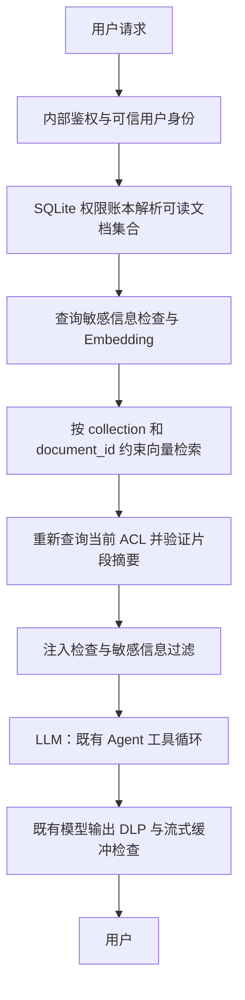

# 权限约束 RAG

文档 API 和 Agent 的 `rag_search` 使用同一个检索服务。第一版权限模型为：上传者是所有者，可以替换指定用户的读取授权；读取者不能转授权或删除文档。部门、角色和跨组织授权不在本版本范围内。



## 身份与权限

- 生产环境必须配置 `WEAVER_INTERNAL_API_KEY`。可信网关应先认证终端用户，删除客户端提供的身份头，再注入 `X-Weaver-User`（或配置的 `WEAVER_AUTH_USER_HEADER`）。内部密钥只提供给网关；持有它的调用方属于身份信任边界。
- 文档 API 在内部鉴权模式下拒绝缺少用户身份的请求。Agent 使用服务端 `SecurityContext`，工具参数不接受用户身份、collection 或授权过滤器。保留身份 `internal` 不能用于 RAG。
- 无内部鉴权的开发模式固定使用单用户 `local`，不提供多用户身份隔离；生产模式即使关闭内容扫描也拒绝这种 RAG 访问。
- 权限独立存储于 `RAG_PERMISSIONS_PATH` 指定的 SQLite 文件。向量元数据中的权限声明不作为授权依据。关闭 `SECURITY_ENABLED` 不会关闭文档 ACL，但会关闭既有注入检测、脱敏和输出扫描；生产应保持开启。
- 所有者的文档保留在其个人 collection；被授权用户可以跨这些 collection 读取明确获准的文档，每个 collection 都带服务端构造的 `document_id IN (...)` 条件。空权限集合直接返回空结果，不调用 embedding 或向量库。
- 每次查询重新解析权限，不缓存授权结果。召回后再次读取权限，并校验 collection、文档 ID、片段 ID 和入库时登记的 SHA-256 内容摘要；文件名和来源取自账本。跨 collection 检索结束后再校验当前可读集合。

## 入库和撤销

上传生成新的文档 UUID 和片段 ID，在 embedding 前执行既有内容检查，向量写入成功后才登记可读文档。embedding 失败会明确失败，不使用零向量。未成功登记的向量无法被检索服务访问。

删除仅允许所有者操作。保留原有按 `source` 删除的接口语义：同名来源的所有自有文档一起删除。先在账本中撤销访问，再删除向量；物理删除失败时仍然拒绝读取，可重试原删除请求清理残留向量。

撤权影响之后的检索及检索时的权限复查。已发送给模型或用户的内容无法收回；本实现不会清除正在进行的 Agent 对话中已有的工具结果，也不承诺撤销在模型生成期间追回已发送的上下文。

## 配置和迁移

```dotenv
RAG_ENABLED=true
RAG_STORE_PATH=data/rag
RAG_PERMISSIONS_PATH=data/rag_permissions.sqlite3
SECURITY_ENABLED=true
```

Agent 配置还需开启 `enabled_tools.rag=true`。原有模型输入／输出保护继续由 `common/security/models.py` 执行；直接文档搜索 API 返回经过检查的检索片段，不调用 LLM。

已有向量没有新的权限记录和内容摘要，因此默认不可检索，不能自动根据文件名推定所有者。部署后应由正确用户重新上传文档；原向量不会自动删除。请一起持久化和备份向量目录与权限账本。多 worker 必须共享账本文件；多主机应先替换为统一的权限数据库。

## API 使用

以下请求均需由可信网关携带内部凭据和已认证用户身份。

1. `POST /api/documents/upload`，表单字段 `file`。响应新增 `document_id`；新文档默认仅所有者可读。
2. 所有者调用 `PUT /api/documents/permissions/{document_id}`，JSON 为 `{"readers":["bob","carol"]}`。这会替换整个读取授权集合；传 `{"readers":[]}` 撤销全部共享，所有者仍可读取。最多 100 个用户标识。
3. `POST /api/documents/search?query=...&n_results=5`，只搜索当前用户拥有或获准读取的文档。`n_results` 范围为 1–20。
4. `GET /api/documents/list?limit=100`，列表和 `total_chunks` 均只统计可读片段。`limit` 范围为 1–1000；列表包含 `document_id` 和片段 `id`。
5. 所有者调用 `DELETE /api/documents/{source}` 撤销并删除其对应来源。

权限修改、检索统计和权限／完整性检查失败写入现有安全审计，记录不包含原始查询或文档正文。权限账本不可用时不会退回无约束检索。

## 验证与后续

`tests/test_rag_permissions.py` 使用真实 SQLite 和 ChromaDB，只替换 embedding 网络调用，验证身份缺失、授权前过滤、撤权竞态、元数据和内容篡改、旧向量默认拒绝、敏感信息与注入处理、删除失败继续拒绝访问，以及 HTTP 上传／授权／搜索／撤权／删除流程。既有 `tests/test_agent_security.py` 验证模型输出与跨 token 凭据过滤。

本次验证：后端全量测试 378 通过、1 跳过；修改文件的项目 Lint、Python 编译、密钥扫描通过；OpenAPI SDK 类型已重新生成，TypeScript SDK 编译和 SSE 解析测试通过。

当前环境没有 `bd` 可执行文件，且仓库已移除 `.beads`，因此以下后续事项暂记于此，待恢复项目 issue tracker 后录入：

- 大规模共享知识库：分页解析权限、限制集合扇出，并在多个 collection 间复用查询向量。
- 部门／角色授权与多主机权限数据库：继续保持检索前约束和检索后复查。
- 文档生命周期管理：清理未登记的失败上传向量和旧版向量；增加权限管理界面。
